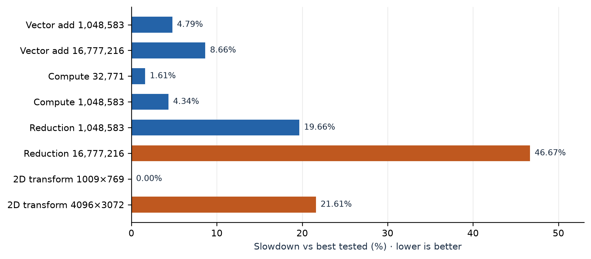

# Architecture-Aware CUDA Kernel Launch Configuration Recommender

How close can an interpretable launch score get to the fastest tested CUDA configuration without timing candidates during recommendation? This NYU Courant course project evaluates that question on a Turing RTX 2080 Ti.

The CUDA/C++ tool queries device limits and compiled-kernel attributes, generates 1D and 2D block/grid candidates, checks residency with the CUDA occupancy API, and ranks feasible launches with the `analytical-v1` model. The score combines grid-limited occupancy, wave fill, tile utilization, row geometry and estimated overhead. `recommend` performs metadata queries and host-side ranking. `evaluate` adds CPU-reference validation, CUDA-event timing, role deduplication and CSV output.

## Benchmarks

| Kernel | Operation |
| --- | --- |
| `vadd` | FP32 vector addition |
| `compute` | 128 dependent FP32 fused multiply-adds per element |
| `reduce` | Shared-memory tree, followed by a second reduction stage |
| `transform` | Row-major weighted direct and horizontally mirrored read |

## Build and run on CIMS

```sh
module load cuda-13.0
make CUDA_ARCH=75
make check
build/gpu-launch recommend --kernel reduce --n 16777216 --device 0
build/gpu-launch recommend --kernel transform --width 4096 --height 3072 --device 0
mkdir -p build/examples
build/gpu-launch evaluate --kernel vadd --n 4103 --device 0 --split calibration --seed 3175 --warmups 1 --rounds 3 --batch 5 --csv build/examples/vadd.csv
```

See [readme.txt](readme.txt) for exact dependencies, output formats and CIMS verification instructions.

## Results

The campaign recorded 2,035 valid CUDA-event batches for 185 distinct workload-launch pairs across four calibration and eight held-out workloads. Each candidate passed its CPU-reference check before receiving five warmups and 11 randomized timing rounds of 20 complete operations. Both stages of the reduction are timed.

Held-out median slowdown versus the best tested launch was **6.72%** (range **0–46.67%**). The recommendation beat the first fixed baseline on **3/8**, the second on **1/8**, and occupancy-only on **4/8**, with one occupancy tie. The largest loss was the 16,777,216-element reduction. The score saturated at the recommended 68-CTA grid even though the fastest tested grid used 136 CTAs at the same block size. The 4096×3072 transform was 21.61% slower than the best tested launch. Fixed launches were competitive.



These measurements cover one evaluated architecture and a finite candidate space. Event timing did not resolve hardware-level mechanisms. GPU-load sampling could miss brief overlap with other work.

## Reproduce the results

```sh
python3 scripts/audit-phase4.py results/raw/phase4 build/audit --verify-manifest
python3 scripts/analyze.py --out build/analysis
# Optional with Matplotlib:
python3 scripts/analyze.py --out build/analysis --figures build/figures
```

- [Final report PDF](report/Final_Report.pdf) and [editable report source](report/build_report.py)
- [Frozen measurement provenance](results/raw/phase4/protocol.txt), [raw checksums](results/raw/phase4/SHA256SUMS), and [audit](results/summary/phase4/audit.json)
- [Workload comparisons](results/summary/phase5/workloads.csv), [configuration statistics](results/summary/phase5/configurations.csv), and [figures](results/figures/)

The frozen CIMS measurement revision in the dataset predates the analysis and distribution snapshot.
